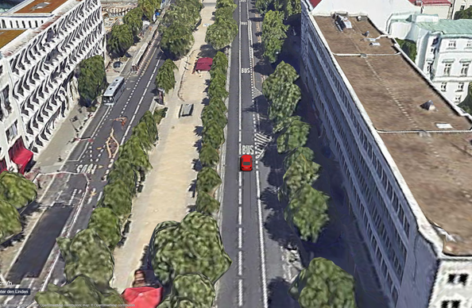

# Driving Berlin



A calm drive through the real, photographed Berlin-Mitte, in the browser. The city is Berlin's
photogrammetric 3D mesh, streamed as you drive; it is not a racing game, there is no clock and
no score to chase.

**Play: <https://tifa365.github.io/driving-berlin/>**

> The game loads about 70 MB to start and more data while driving. Best used on Wi-Fi and on a
> computer, to save data.

The game's texts are in German.

## How to play

| Key | |
|---|---|
| Arrows or W A S D | drive and steer; hold back at a standstill to reverse |
| Space | hop (frees a stuck car) |
| Esc | menu; the game pauses (settings, controls, map, back to the start) |
| N | full-screen map |
| R | back to the start (progress is kept) |
| B | car or bus |
| U | turn around (also at the edge of the map) |
| V | camera behind the car / north up |
| C | street obstacles on / off (they start off; buildings always block) |
| M | next mood (day, moon, snow) |
| H | the controls page |

Phones and tablets get experimental touch controls: an on-screen stick and buttons. Hold the
phone sideways.

Game controllers work: left stick steers, triggers are gas and brake, A jumps, Start opens the menu.

Settings (mood, vehicle, top speed, detail, camera view and height) live in the menu and are
remembered between visits. "Neustart" in the menu starts the hunt over; "Auf Standard
zurücksetzen" in the settings restores the defaults.

**Things to find.** Berlin bears are hidden around Mitte; drive into one to collect it (the menu
counts them). There are also the S-Bahn tracks on the Stadtbahn viaduct, a roof route with its
own lift, and a few sights that got something extra. And there is more to
discover than this list says.

The playable area is Ortsteil Mitte, about 4.4 x 4.1 km. A soft glass wall marks its edge.

## Run it locally

You need Python 3 and a recent desktop browser. No build step, no packages.

```bash
git clone https://github.com/tifa365/driving-berlin
cd driving-berlin
python3 serve.py 8765            # then open http://127.0.0.1:8765/
```

What works out of the box, and what does not:

- **The level data (`levels/mitte_all/`) and the mesh tiles are not in this repository.** A plain
  clone serves the code, but the game stops on its loading screen because the level files are
  missing.
- **Quickest local copy:** the `gh-pages` branch is the published site, with the level data in it;
  its tiles come from the Hugging Face dataset `driving-berlin-tiles`. Serve it with any static
  server:
  ```bash
  git clone --branch gh-pages https://github.com/tifa365/driving-berlin driving-berlin-site
  cd driving-berlin-site && python3 -m http.server 8000
  ```
- **Developing with local tiles:** `serve.py` serves the mesh tiles under `/tiles/` from
  `../berlin_mesh_2025_wab/` next to this folder, and the build scripts expect the parent
  project's helper modules and an OpenStreetMap extract. See [AGENTS.md](AGENTS.md) for the full
  setup and the build order.
- `python3 serve.py 8765 --bind 0.0.0.0` makes the game reachable from a phone on the same network.

## Tests

`tools/test.sh` runs static checks, one headless start-up and the drive tests (needs Node, a
Chrome or Chromium, and `python3 serve.py 8765` running). Exit code 0 means all passed.

## Licence and credits

*Driving Berlin* is a free, non-commercial hobby project. The 3D mesh belongs to its provider
(below); the project is not affiliated with or endorsed by Berlin Partner or the State of Berlin.

- **3D mesh:** *3D-Meshmodell Berlin 2025 © Berlin Partner für Wirtschaft und Technologie GmbH*.
  Source: the Berlin 3D download portal (`https://www.businesslocationcenter.de/berlin3d-downloadportal/`),
  listed in the Berlin open-data register as "3D-Meshmodell Berlin"
  (`https://daten.berlin.de/datensaetze/3d-meshmodell-berlin`). The data belongs to the provider and its
  terms of use apply. In the game: the city picture (3D tiles) and the street heights.
- **OpenStreetMap:** © OpenStreetMap contributors, ODbL 1.0 (`https://www.openstreetmap.org/copyright`).
  In the game: streets and street names, building outlines (walls), water, bridges, tunnels, the
  S-Bahn route, Ortsteile, the map.
- **Baumkataster Berlin** (street trees and park trees, WFS `https://gdi.berlin.de/services/wfs/baumbestand`,
  layers `baumbestand:strassenbaeume`, `baumbestand:anlagenbaeume`; cached by `build_clutter.py`): Geoportal Berlin,
  dl-de/zero-2.0. In the game: tree trunks as obstacles (only where the mesh shows a crown).
- **Straßenbefahrung 2014** (WFS `https://gdi.berlin.de/services/wfs/strassenbefahrung`, layers
  `cm_fahrbahn`, `ck_parkflaeche`, `ca_haltebereich_bus`, `bz_gleiskoerper_strab`): Geoportal
  Berlin, dl-de/zero-2.0. In the game: the clear carriageway (no obstacles on the road).
- **three.js** (MIT, from the jsDelivr CDN). In the game: 3D rendering.
- **Box2D** (`Box2D.js`, box2dweb, © Erin Catto, zlib licence). In the game: driving physics.
- **Sign fonts:** D-DIN Bold and D-DIN Condensed Bold, © 2017 Datto Inc., SIL Open Font License 1.1
  (`assets/fonts/`, licence in `assets/fonts/OFL-1.1.txt`, `FONTLOG.txt`). In the game: the
  street-name plates, the title and the place-name sign.
- **Sky picture:** `assets/sky/sky.webp`, from the Skyfall Protocol project, used with its
  author's permission. In the game: the sky (no mood, day
  mood) and the sky light on car and bus.
- **Leaflet** (BSD-2, from cdnjs) is used only by `map.html`, a developer tool page that is not
  published.

In the game the same list appears as the credit line on the loading screen and as "Daten &
Quellen" on the menu's Info page; both come from `DATASETS` / `SOFTWARE` in `js/intro.js`. Keep
this section in step with that list.

---

Working on the code? See [AGENTS.md](AGENTS.md).
